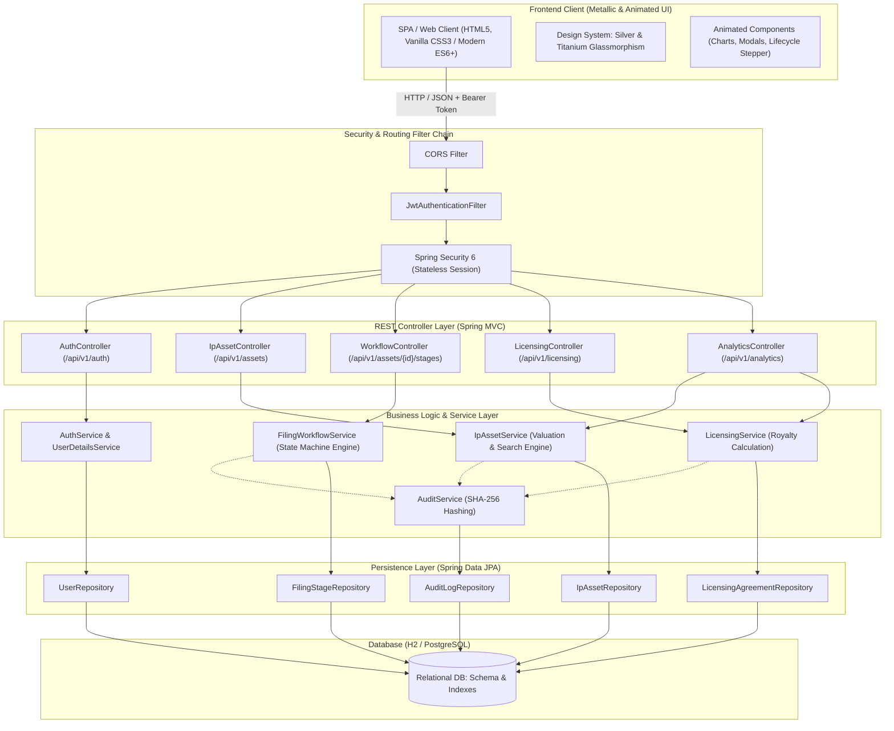
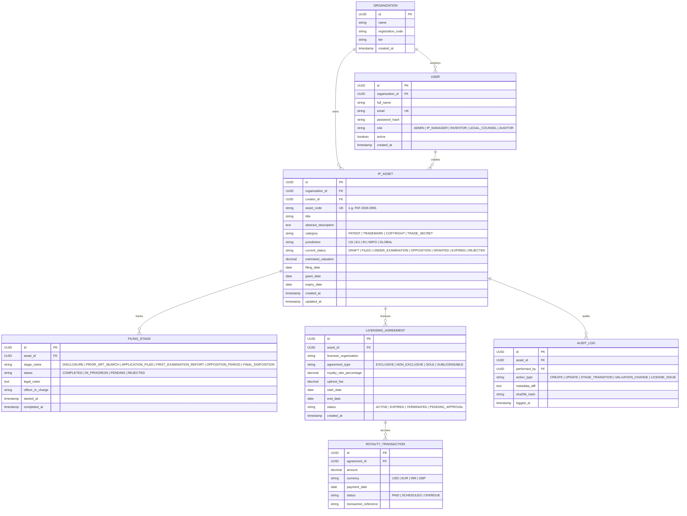

# 🛡️ ARGENT-IP : Enterprise Intellectual Property & Digital Asset Intelligence Suite
> **Internet Programming (IP) Capstone & Mini-Project Blueprint**  
> *Tailored for Antigravity Agentic Development, Spring Boot 3.3+, and High-End Metallic Animated UI*

---

## 1. Executive Summary & Project Vision

**ARGENT-IP** is an enterprise-grade Intellectual Property (IP) lifecycle and portfolio intelligence platform designed for law firms, R&D labs, and tech enterprises. Built to satisfy both rigorous academic criteria for an **Internet Programming (IP) Mini-Project** and real-world commercial standards, it orchestrates the entire journey of intellectual assets—from initial invention disclosure and patent/trademark filing prosecution to licensing agreements, valuation tracking, and royalty auditing.

### Key Highlights
- **Architecture**: Spring Boot 3.3+ (Java 21) RESTful backend + Layered Service Architecture + JPA/Hibernate Relational Model + H2/PostgreSQL.
- **Frontend Experience**: Ultra-premium, dark-mode, animated frontend leveraging a **Sleek Grey, Silver, Platinum, and Brushed Titanium** aesthetic with liquid-mercury sheen, glowing border reflections, and micro-interactions.
- **Security & Integrity**: Role-Based Access Control (RBAC), JWT Stateless Authentication, and an immutable SHA-256 hashed audit log.

---

## 2. System Architecture



---

## 3. Relational Data Model & JPA Entities

### Entity Relationship Diagram (ERD)



---

## 4. Spring Boot 3 RESTful API Endpoints

All endpoints are versioned under `/api/v1` and accept/return `application/json`. Protected endpoints require standard `Authorization: Bearer <JWT>` header.

### 4.1 Authentication & User Management
| Method | Endpoint | Access | Description |
|---|---|---|---|
| `POST` | `/api/v1/auth/register` | Public | Register new enterprise user & organization |
| `POST` | `/api/v1/auth/login` | Public | Authenticate user, receive JWT & user profile |
| `GET` | `/api/v1/auth/me` | Authenticated | Retrieve current user profile and RBAC permissions |

### 4.2 IP Asset Management
| Method | Endpoint | Access | Description |
|---|---|---|---|
| `GET` | `/api/v1/assets` | Authenticated | Paginated, filtered search (category, jurisdiction, status, search query) |
| `POST` | `/api/v1/assets` | IP_MANAGER, INVENTOR | Register new IP Asset (Patent, Trademark, etc.) |
| `GET` | `/api/v1/assets/{id}` | Authenticated | Retrieve full asset details including current stage & valuation |
| `PUT` | `/api/v1/assets/{id}` | IP_MANAGER, ADMIN | Update asset details, abstract, metadata |
| `DELETE` | `/api/v1/assets/{id}` | ADMIN | Soft delete / archive an IP asset |
| `PATCH` | `/api/v1/assets/{id}/valuation` | IP_MANAGER, LEGAL_COUNSEL | Re-estimate or recalculate asset valuation |

### 4.3 Lifecycle & Stage Progression
| Method | Endpoint | Access | Description |
|---|---|---|---|
| `GET` | `/api/v1/assets/{id}/stages` | Authenticated | Get full chronological timeline and examination stages |
| `POST` | `/api/v1/assets/{id}/stages` | LEGAL_COUNSEL, ADMIN | Advance asset to next legal stage with examiner notes |
| `PUT` | `/api/v1/assets/{id}/stages/{stageId}` | LEGAL_COUNSEL | Update stage review status or legal notes |

### 4.4 Licensing & Royalties
| Method | Endpoint | Access | Description |
|---|---|---|---|
| `GET` | `/api/v1/licensing` | Authenticated | List all active/pending licensing agreements |
| `POST` | `/api/v1/licensing` | IP_MANAGER, ADMIN | Execute new licensing contract for an asset |
| `GET` | `/api/v1/licensing/{id}/royalties` | Authenticated | Fetch transaction ledger for a specific agreement |
| `POST` | `/api/v1/licensing/{id}/royalties` | IP_MANAGER, ADMIN | Record royalty payment transaction |

### 4.5 Executive Analytics & Portfolio Intelligence
| Method | Endpoint | Access | Description |
|---|---|---|---|
| `GET` | `/api/v1/analytics/portfolio-summary` | Authenticated | Total valuation, asset count by category, jurisdiction breakdown |
| `GET` | `/api/v1/analytics/timeline-forecast` | Authenticated | Renewal & grant expiration forecast for next 12 months |
| `GET` | `/api/v1/assets/{id}/audit-trail` | AUDITOR, ADMIN | Immutable cryptographic audit log history |

---

## 5. Sleek Grey, Silver & Metallic Frontend Design System

The visual design is inspired by high-end luxury automotive interfaces (Porsche/Mercedes GT), aerospace telemetry, and brushed titanium craftsmanship. It combines deep slate obsidian backgrounds with reflective metallic gradients, silver borders, and subtle glowing ice-blue status accents.

### 5.1 Color Tokens & Design System

```css
:root {
  /* Deep Dark Obsidian / Space Greys */
  --bg-deep-void: #07090E;
  --bg-surface-dark: #0D1117;
  --bg-surface-elevated: #161B22;
  --bg-surface-card: #1C2128;
  
  /* Metallic, Silver & Platinum Gradients */
  --silver-bright: #F1F5F9;
  --silver-platinum: #E2E8F0;
  --silver-medium: #94A3B8;
  --silver-muted: #64748B;
  --silver-dark-steel: #334155;
  
  /* Metallic Gradient Shimmers */
  --metal-gradient-primary: linear-gradient(135deg, #FFFFFF 0%, #CBD5E1 50%, #94A3B8 100%);
  --metal-gradient-sheen: linear-gradient(180deg, rgba(255, 255, 255, 0.15) 0%, rgba(255, 255, 255, 0.02) 100%);
  --metal-card-surface: linear-gradient(145deg, rgba(30, 38, 49, 0.75) 0%, rgba(15, 23, 42, 0.85) 100%);
  --metal-border-subtle: linear-gradient(135deg, rgba(248, 250, 252, 0.25) 0%, rgba(148, 163, 184, 0.08) 50%, rgba(255, 255, 255, 0.2) 100%);
  
  /* Precision Accent Signals */
  --accent-cyan-ice: #38BDF8;      /* Active / Focus / Primary Pulse */
  --accent-silver-glow: rgba(226, 232, 240, 0.45);
  --status-granted-emerald: #10B981;
  --status-examination-amber: #F59E0B;
  --status-opposition-rose: #F43F5E;
  
  /* Shadows & Reflections */
  --shadow-metallic-card: 0 8px 32px 0 rgba(0, 0, 0, 0.55), inset 0 1px 0 rgba(255, 255, 255, 0.12);
  --shadow-metallic-hover: 0 16px 40px -8px rgba(0, 0, 0, 0.7), 0 0 20px rgba(148, 163, 184, 0.2), inset 0 1px 1px rgba(255, 255, 255, 0.25);
  --shadow-metallic-button: 0 4px 15px rgba(255, 255, 255, 0.12), inset 0 1px 0 rgba(255, 255, 255, 0.35);

  /* Typography */
  --font-heading: 'Space Grotesk', -apple-system, BlinkMacSystemFont, sans-serif;
  --font-body: 'Plus Jakarta Sans', -apple-system, BlinkMacSystemFont, sans-serif;
  --font-mono: 'JetBrains Mono', monospace;
}
```

### 5.2 Micro-Animations & Dynamic Interactions

1. **Liquid Chrome Shimmer**: On hovering over metric summary cards, a diagonal metallic reflection (`linear-gradient(45deg, transparent 20%, rgba(255,255,255,0.18) 50%, transparent 80%)`) sweeps across the card at a smooth 600ms bezier transition.
2. **Metallic Stepper Node Glow**: In the Filing Stage timeline, completed stages radiate a solid brushed silver disk, active stages feature a pulsing electric-cyan halo, and upcoming stages remain quiet steel grey.
3. **Interactive Valuation Counter**: Key metric numbers count up smoothly upon dashboard mount.
4. **Brushed Metal Border Glow**: Interactive input fields, table rows, and modal containers have a dynamic reflective border that responds to cursor focus.

---

## 6. Project Structure & Code Layout

```
ipmini-project/
├── backend/
│   ├── pom.xml
│   └── src/
│       ├── main/
│       │   ├── java/com/argent/ip/
│       │   │   ├── ArgentIpApplication.java
│       │   │   ├── config/
│       │   │   │   ├── SecurityConfig.java
│       │   │   │   ├── JwtAuthenticationFilter.java
│       │   │   │   ├── JwtTokenProvider.java
│       │   │   │   └── CorsConfig.java
│       │   │   ├── controller/
│       │   │   │   ├── AuthController.java
│       │   │   │   ├── IpAssetController.java
│       │   │   │   ├── FilingWorkflowController.java
│       │   │   │   ├── LicensingController.java
│       │   │   │   └── AnalyticsController.java
│       │   │   ├── dto/
│       │   │   │   ├── request/
│       │   │   │   └── response/
│       │   │   ├── entity/
│       │   │   │   ├── Organization.java
│       │   │   │   ├── User.java
│       │   │   │   ├── IpAsset.java
│       │   │   │   ├── FilingStage.java
│       │   │   │   ├── LicensingAgreement.java
│       │   │   │   ├── RoyaltyTransaction.java
│       │   │   │   └── AuditLog.java
│       │   │   ├── repository/
│       │   │   │   ├── UserRepository.java
│       │   │   │   ├── IpAssetRepository.java
│       │   │   │   ├── FilingStageRepository.java
│       │   │   │   ├── LicensingAgreementRepository.java
│       │   │   │   └── AuditLogRepository.java
│       │   │   └── service/
│       │   │       ├── AuthService.java
│       │   │       ├── IpAssetService.java
│       │   │       ├── FilingWorkflowService.java
│       │   │       └── AnalyticsService.java
│       │   └── resources/
│       │       ├── application.yml
│       │       ├── schema.sql
│       │       └── data.sql
├── frontend/
│   ├── index.html
│   ├── css/
│   │   ├── design-system.css
│   │   ├── metallic-effects.css
│   │   └── components.css
│   ├── js/
│   │   ├── app.js
│   │   ├── api.js
│   │   ├── store.js
│   │   └── components/
│   │       ├── MetricsBar.js
│   │       ├── AssetTable.js
│   │       ├── StageTimeline.js
│   │       └── NewAssetModal.js
│   └── assets/
│       └── icons/
└── README.md
```

---

## 7. Step-by-Step Execution Plan

1. **Scaffold Directory**: Initialize the Spring Boot backend (`com.argent.ip`) and the modern frontend client.
2. **Build Backend Core**:
   - Write Spring Data JPA entities with audit timestamp listeners.
   - Configure Spring Security with stateless JWT authorization.
   - Seed realistic demo records: Artificial Intelligence Patents, Biotech Trademarks, Quantum Computing Copyrights, and active licensing contracts.
3. **Assemble Animated Metallic Frontend**:
   - Implement `design-system.css` with the silver, steel, and metallic color tokens.
   - Build responsive layout: Executive Header, Metallic KPI Metric Cards, Real-Time Filter & Search Table, Dynamic Lifecycle Visualizer, and Modal Dialogs.
   - Add responsive fallback mock API client so frontend can be demonstrated instantly with zero setup.
4. **Integration & End-to-End Testing**:
   - Verify all CRUD and stage transition flows.
   - Run the local dev server and open in browser to ensure visual perfection.
